---
title: "AI 기반 시각장애인 버스 정류장 안내 시스템"
description: "컴퓨터 비전과 임베디드 시스템을 활용한 버스 안내 프로젝트"
date: 2026-11-01
draft: false
categories:
    - Projects
tags:
    - Raspberry Pi
    - Arduino
    - YOLO
    - OpenCV
---

## Project Overview

### 프로젝트 소개

본 프로젝트는 시각장애인의 대중교통 이용 편의성을 높이기 위해 개발한 AI 기반 버스 정류장 안내 시스템입니다.

Raspberry Pi의 카메라와 YOLO 객체 인식 모델을 활용하여 흰지팡이를 탐지하고, Arduino 기반 점자 출력 장치와 연동해 버스 도착 정보를 전달하도록 구현하였습니다.

### 프로젝트 정보

- **프로젝트명:** AI 기반 시각장애인 버스 정류장 안내 시스템
- **개발 기간:** 2026.09.01 ~ 2026.10.11
- **진행 상태:** 완료
- **주요 기술:** Python, OpenCV, YOLO, Raspberry Pi, Arduino, Bluetooth

### Development Purpose

시각장애인은 버스 정류장에서 버스 번호와 도착 정보를 시각적으로 확인하기 어려울 수 있습니다.

이러한 문제를 해결하기 위해 컴퓨터 비전 기술로 사용자의 흰지팡이를 인식하고, 점자 출력 장치를 통해 필요한 버스 정보를 전달하는 시스템을 개발하였습니다.

### My Role

- Raspberry Pi 기반 카메라 영상 처리 및 객체 인식 시스템 구현
- YOLO 모델 학습 및 흰지팡이 탐지 기능 개발
- Raspberry Pi와 Arduino 간 Bluetooth 통신 구현
- 서보모터를 활용한 점자 출력 장치 연동
- 시스템 동작 검증 및 통신 안정성 개선

---

## Development

### System Architecture

본 시스템은 Raspberry Pi와 Arduino를 중심으로 구성된 AI 기반 임베디드 안내 시스템입니다.

  <figure style="flex: 0 0 500px; width: 500px; margin: 0;">
    
      라즈베리파이를 이용한 CCTV장치
  </figure>

  <figure style="flex: 0 0 500px; width: 500px; margin: 0;">
    
      라즈베리파이를 이용한 CCTV장치_내부
  </figure>

**1. Camera & Object Detection**

Raspberry Pi Camera로 입력된 영상을 YOLO 객체 인식 모델과 OpenCV를 활용하여 분석합니다. 흰지팡이가 일정 시간 이상 탐지되면 안내 시스템을 활성화합니다.

**2. Bus Information Processing**

Raspberry Pi에서 목적지에 따른 버스 경로를 탐색하고, 버스 번호와 남은 도착 시간을 관리합니다. 최적의 버스 경로를 탐색하기 위해 BFS 알고리즘을 활용하였습니다.

**3. Bluetooth Communication**

Raspberry Pi와 Arduino는 HC-05 Bluetooth 모듈을 통해 데이터를 주고받습니다. Raspberry Pi는 버스 정보를 전송하고 Arduino로부터 목적지 선택 및 안내 종료 명령을 수신합니다.

**4. Braille Output Device**

Arduino에 연결된 6개의 서보모터를 이용하여 점자 돌기를 제어합니다. 이를 통해 사용자에게 버스 안내 정보를 촉각적으로 제공합니다.

**5. LED Matrix**

MAX7219 기반 8×8 LED Matrix를 활용하여 시스템 시작 및 활성화 상태를 표시합니다.

  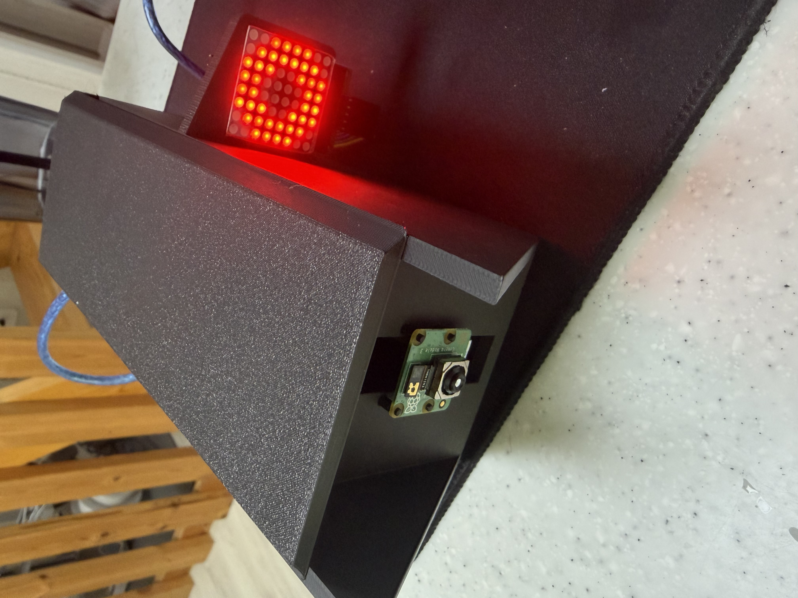

  

    실제 CCTV 장치 활성화 상태 표시
  

---

## Implementation Process

### 1. YOLO-based White Cane Detection

**데이터셋 준비 및 모델 학습**

시각장애인의 흰지팡이를 탐지하기 위해 YOLO 기반 객체 인식 모델을 학습하였습니다.

Roboflow의 White Cane 데이터셋을 활용하였으며, YOLO11n 모델을 선택하여 객체 탐지 모델을 구성하였습니다.

주요 학습 설정은 다음과 같습니다.

- **Model:** YOLO11n
- **Dataset:** White Cane Dataset (Roboflow)
- **Epochs:** 50
- **Image Size:** 640 × 640
- **Batch Size:** 16
- **Detection Class:** white_cane

**모델 변환 및 Raspberry Pi 적용**

학습된 YOLO 모델을 Raspberry Pi 환경에서 실행하기 위해 ONNX 형식으로 변환하였습니다.

변환한 모델은 OpenCV DNN 모듈을 이용하여 실행하도록 구성하였습니다.

이를 통해 Raspberry Pi Camera로 입력된 영상에서 흰지팡이를 실시간으로 탐지하도록 구현하였습니다.

**탐지 안정성 개선**

카메라 영상에서 흰지팡이가 일시적으로 탐지되는 경우에도 시스템이 바로 활성화되지 않도록 하였습니다.

흰지팡이가 약 2초 동안 지속적으로 탐지되면 안내 시스템을 활성화하도록 상태 전환 로직을 구현하여 오작동을 줄이고자 하였습니다.

  <figure style="flex: 0 0 500px; width: 500px; margin: 0;">
    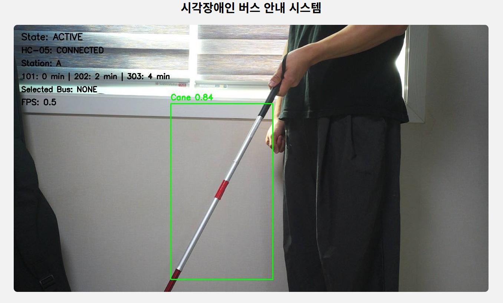
      YOLO 흰지팡이 탐지 성공 화면
  </figure>

  <figure style="flex: 0 0 500px; width: 500px; margin: 0;">
    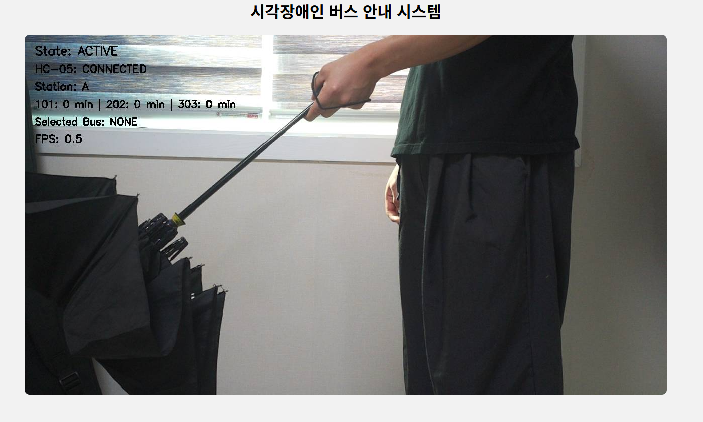
      YOLO 흰지팡이 미탐지 화면
  </figure>

### 2. Bluetooth Communication

**Raspberry Pi와 Arduino 간 무선 통신**

Raspberry Pi와 Arduino 사이의 데이터 전달을 위해 HC-05 Bluetooth 모듈을 활용하였습니다.

Raspberry Pi는 객체 인식과 버스 정보 처리를 담당하고, Arduino는 사용자 입력 및 점자 출력 장치의 서보모터 제어를 담당하도록 기능을 분리하였습니다.

주요 통신 명령은 다음과 같습니다.

- **READY:** 안내 시스템 준비 상태 전달
- **BUS:** 버스 번호 및 남은 도착 시간 전달
- **DEST:** Arduino에서 선택한 목적지 정보 전달
- **STOP:** 사용자 안내 종료 요청

  <figure style="flex: 0 0 500px; width: 500px; margin: 0;">
    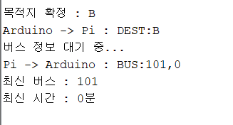
      통신 명령(아두이노)
  </figure>

  <figure style="flex: 0 0 500px; width: 500px; margin: 0;">
    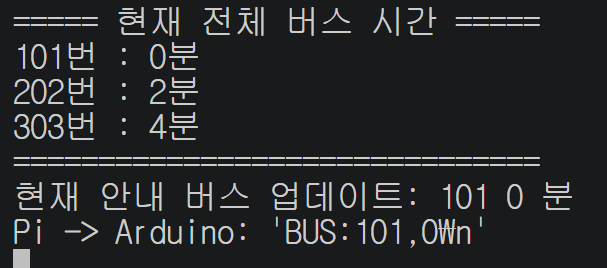
      통신 명령(라즈베리파이)
  </figure>

**통신 방식**

(1). [송신] 휴대용 점자 출력 장치 (정류장 선택) -> [수신] CCTV 장치 (정류자 정보 받음)

(2). [송신] CCTV 장치 (선택한 정류장으로 가는 버스 정보 보내기) -> [수신] 휴대용 점자 출력 장치 (버스 정보 받음)

     만약에 101번 버스가 1분 후에 도착이면, 
     [1 표현] [0 표현] [1 표현] (delay) [1 표현] 이런 형태로 점자를 출력합니다.    

     

**통신 안정성 개선**

Bluetooth 연결이 끊어지는 상황에 대응하기 위해 자동 재연결 기능을 구현하였습니다.

재연결 이후에도 버스 도착 시간과 사용자 상태를 유지하도록 구성하였으며, 필요한 안내 정보를 다시 전송하여 시스템이 정상적으로 동작하도록 개선하였습니다.

### 3. Braille Output Device

  <figure style="flex: 0 0 500px; width: 500px; margin: 0;">
    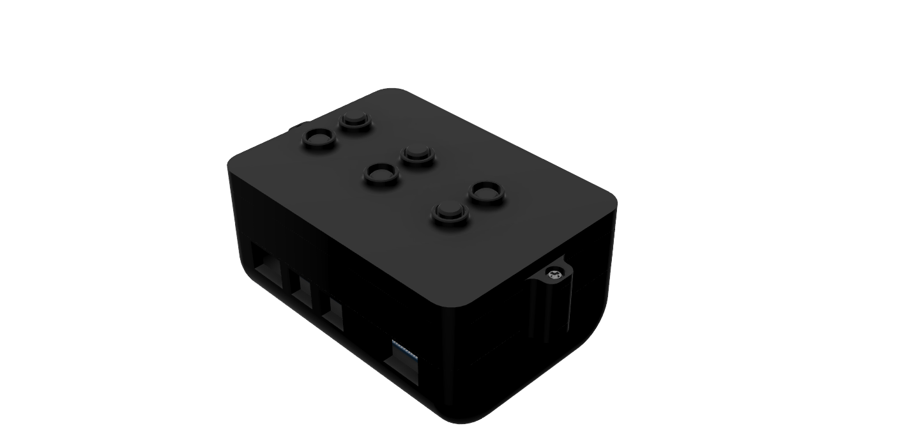
      아두이노를 이용한 휴대용 점자 출력 장치
  </figure>

  <figure style="flex: 0 0 500px; width: 500px; margin: 0;">
    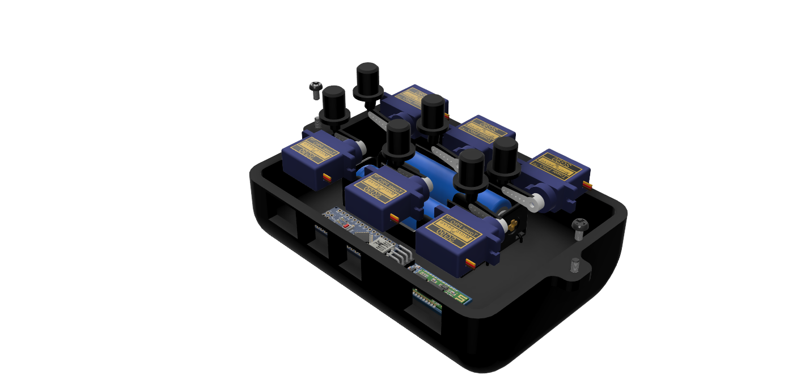
      휴대용 점자 출력 장치_내부
  </figure>

**6개의 서보모터를 활용한 점자 출력 장치**

시각장애인에게 촉각적으로 정보를 전달하기 위해 Arduino와 6개의 서보모터를 활용한 점자 출력 장치를 구현하였습니다.

각 서보모터는 점자의 6개 돌기 중 하나를 제어하며, 출력할 정보에 따라 돌기의 상태가 달라지도록 구성하였습니다.

**하드웨어 제어 및 시스템 연동**

Arduino에서 Bluetooth로 수신한 명령을 처리하고, 점자 출력 장치와 연동하도록 구현하였습니다.

이를 통해 Raspberry Pi의 영상 인식과 버스 정보 처리 기능을 실제 하드웨어 출력 장치와 연결하였습니다.

---

## Project Results

### 1. 완성된 시스템

Raspberry Pi, Arduino, 카메라 및 점자 출력 장치를 통합하여 AI 기반 시각장애인 버스 정류장 안내 시스템을 구현하였습니다.

카메라를 통한 흰지팡이 탐지, 목적지에 따른 버스 노선 선택, 블루투스 통신 및 점자 정보 출력 기능을 하나의 시스템으로 통합하였습니다.

  <figure style="margin: 0; text-align: center;">
    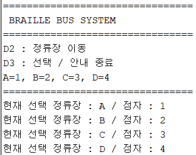

  <figcaption style="margin-top: 10px;">
      (1). 정류장 선택 [아두이노]
    </figcaption>
  </figure>

  <figure style="margin: 0; text-align: center;">
    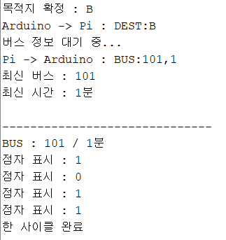아두이노]"
         style="width: 100%; height: 250px; object-fit: contain; display: block;">

  <figcaption style="margin-top: 10px;">
      (2). 버스 정보 받기 [라즈베리파이->아두이노]
    </figcaption>
  </figure>

중간에 다른 정류장을 선택하고 싶을 땐 STOP 명령어를 보내면, 기존의 돌리고 있던 점자판 동작 사이클을 끝낸 후 다시 선택 모드로 들어갑니다. 

  <figure style="margin: 0; text-align: center;">
    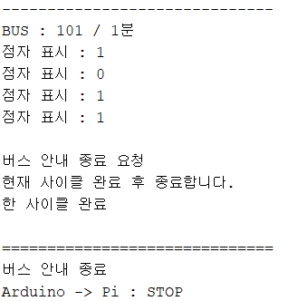 기존의 사이클 돌린 후 STOP 명령어 보내기 "
         style="width: 100%; height: 250px; object-fit: contain; display: block;">

  <figcaption style="margin-top: 10px;">
      (1). STOP -> 기존의 사이클 돌린 후 STOP 명령어 보내기 
    </figcaption>
  </figure>

  <figure style="margin: 0; text-align: center;">
    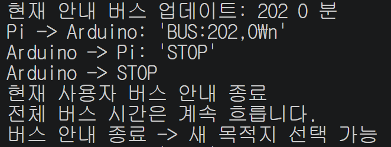

  <figcaption style="margin-top: 10px;">
      (2). STOP 명령어 받은 후 다시 대기모드 
    </figcaption>
  </figure>

STOP 후에도 CCTV장치 내에서 버스의 시간은 계속 흐르게 했습니다. 

### 2. 시스템 작동 영상

아래 영상은 흰지팡이 인식 이후 버스 정보가 Arduino 기반 점자 출력 장치로 전달되어 출력되는 과정을 보여줍니다.

Raspberry Pi에서 처리한 버스 번호와 남은 시간을 블루투스 통신으로 Arduino에 전달하고, Arduino는 수신한 정보를 6개의 서보모터를 이용해 점자로 출력합니다.

    [영상 속 점자 출력 정보]

    출력 내용: 101 (공백) 0

    의미: 101번 버스 / 남은 시간 0분

    동작 결과: 버스 번호와 남은 시간이 점자 출력 장치를 통해 
    정상적으로 표시되는 것을 확인하였습니다.

<video controls playsinline preload="metadata"
       style="width: 50%; height: auto; border-radius: 10px;">
  <source src="Arduino_device_final.mp4" type="video/mp4">
  브라우저에서 동영상 재생을 지원하지 않습니다.
</video>

### 3. Problem Solving (개발 중 문제 해결 경험)

프로젝트 개발 과정에서 객체 인식의 안정성, Bluetooth 통신 연결과 관련된 문제를 경험하였습니다. 각 문제의 원인을 분석하고 해결하는 과정을 통해 시스템의 안정성을 개선하였습니다.

**1. 흰지팡이 객체 인식의 안정성 개선**

    [문제점]

    - 카메라 영상에서 흰지팡이가 일시적으로 탐지되는 상황에서도 
    안내 시스템이 활성화될 가능성이 있었습니다. 
    단순히 한 프레임의 탐지 결과만으로 시스템을 작동시키면 
    불필요한 안내가 발생할 수 있었습니다.

    [해결 과정]

    - 흰지팡이가 탐지되면 즉시 시스템을 활성화하는 대신, 2초 동안 지속적으로 탐지되는지 
    확인하는 단계를 추가하였습니다.
    이를 통해 일시적인 탐지 결과에 의한 시스템 활성화를 줄이도록 설계하였습니다.

    [결과]

    - 객체 인식 결과를 일정 시간 검증한 후 안내 기능이 활성화되도록 
    구현하여 시스템 동작의 안정성을 높였습니다.

  <figure style="margin: 0; text-align: center;">
    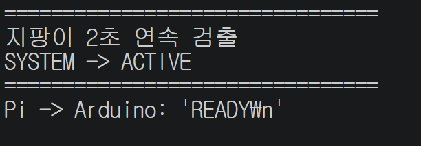

  <figcaption style="margin-top: 10px;">
      지팡이 2초 검출 성공
    </figcaption>
  </figure>

  <figure style="margin: 0; text-align: center;">
    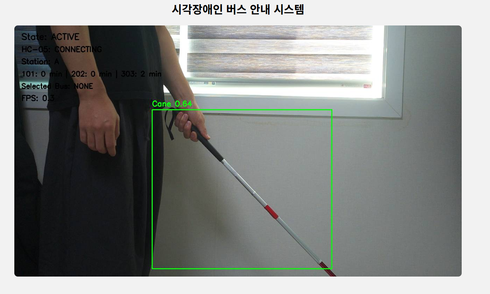

  <figcaption style="margin-top: 10px;">
      지팡이 탐지 화면
    </figcaption>
  </figure>

**2. Bluetooth 연결 해제 및 재연결 문제**

    [문제점]

    - Raspberry Pi와 Arduino 사이의 Bluetooth 연결이 끊어질 경우, 
    점자 출력 장치로 버스 정보를 전달할 수 없는 문제가 발생하였습니다.
    또한 재연결 시 버스 도착 예정 시간이 초기화되면 
    기존 안내 정보와 실제 경과 시간 사이에 차이가 발생할 수 있었습니다.

    [해결 과정]

    - Bluetooth 연결이 끊어졌을 때 일정 시간 후 자동으로 재연결하는 기능을 구현하였습니다.
    재연결 이후에는 READY 명령으로 통신 상태를 복구하고, 기존에 관리하던 버스 번호와 
    남은 시간을 유지한 상태로 안내 정보를 다시 전송하도록 수정하였습니다.

    [결과]

    - Bluetooth 연결이 일시적으로 끊어지더라도 재연결 이후 
    기존 안내 상태를 복구할 수 있도록 개선하였습니다.

  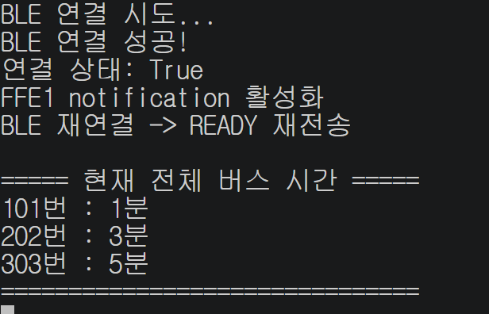

  

    (라즈베리파이) 재연결 장면
  

### 4. Future Improvements (향후 개선 방향)

본 프로젝트를 통해 AI 객체 인식과 하드웨어 기반 점자 안내 시스템을 구현하였으며, 향후 다음과 같은 기능을 추가하여 시스템의 실용성을 높이고자 합니다.

**1. 실시간 버스 도착 정보 연동**

    - 현재는 미리 설정한 버스 노선과 도착 시간을 기반으로 안내 정보를 제공합니다. 
    향후 공공데이터 API를 연동하여 실제 버스 위치 및 도착 예정 시간을 
    실시간으로 안내하도록 개선할 계획입니다.

**2. 객체 인식 성능 및 환경 적응력 향상**

    - 다양한 조명과 날씨, 카메라 촬영 환경에서도 흰지팡이를 안정적으로 인식할 수 있도록 
    학습 데이터를 확장하고 객체 인식 모델을 개선할 계획입니다.

**3. 점자 출력 장치의 소형화 및 편의성 개선**

    - 현재 제작한 Arduino 기반 점자 출력 장치를 더욱 소형화하고, 
    점자 출력 속도 및 사용자 조작 편의성을 개선하여 실제 버스 정류장에서 
    활용하기 적합한 형태로 발전시키고자 합니다.

### 5. Source Code

본 프로젝트의 Raspberry Pi 및 Arduino 소스코드/모델링 파일은 GitHub에서 확인할 수 있습니다.

**GitHub Repository:** [AI-Bus-Stop-System](https://github.com/PraiseChanKim/AI-Bus-Stop-System)

